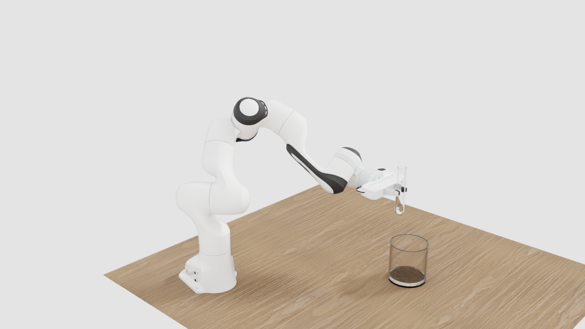

# Isaac Sim Fluid Lab

液滴撞击、水面渲染与 Franka 试管倒水的学习实验。包含可观察的仿真结果、目标水量反馈控制，以及简短的实验记录。



## 实验入口

| 文件 | 内容 |
| --- | --- |
| `droplet_milkcrown_newton_surface.py` | milkcrown 连续水面、透明水材质和桌面切换 |
| `droplet_milkcrown_newton.py` | milkcrown 的隐式 MPM 实现 |
| `robot_testtube_pour.py` | 预握试管→抬起移动→倾倒→扶正；支持实时求解、可选物理缓存回放和 10 秒视频 |
| `robot_target_volume_pour.py` | 实时 PBF 液体反馈，选择 20 / 30 / 40 mL 后自动扶正 |

机器人使用预握试管与 IK 运动学控制，液体由求解器计算。目标水量示例是反馈控制基准，尚未训练神经网络策略；没有模拟摩擦抓持、液体反力或力矩反馈。mL 按粒子体积估算，尚未校准为真实定量实验。

## 环境与启动

本次验证环境：Windows、NVIDIA RTX 4090、Isaac Sim **6.2.0-rc.14**、SDK 自带 Python 3.12 与 Newton/Warp。使用 SDK 配套依赖；本项目不附带 Isaac Sim 安装程序，也不通过普通 `pip install` 替换其物理引擎。

在 PowerShell 中设置安装目录，进入本仓库后运行：

```powershell
$env:ISAAC_SIM_ROOT = "C:\omninverse"
& "$env:ISAAC_SIM_ROOT\isaac-sim.bat" --exec "$PWD\launch.py"
```

如果 Isaac Sim 已经打开，在 Window → Script Editor 中运行以下代码。把 `project` 换成仓库的实际路径，以便 Script Editor 的临时缓冲也能正确找到项目：

```python
from pathlib import Path
import sys

project = Path(r"D:\projects\isaac-sim-fluid-lab")
sys.path.insert(0, str(project))
script = project / "robot_target_volume_pour.py"
exec(compile(script.read_text(encoding="utf-8"), str(script), "exec"),
     {"__name__": "__main__", "__file__": str(script)})
```

初始化后，在 **Target volume pouring** 面板选择 **20 / 30 / 40 mL → Play**。Pause 暂停，Reset 复位，Test 20 / 30 / 40 mL 可重新验证三项。文件顶部 `TARGET_VOLUME_ML` 设置初始目标。

`launch.py` 默认启动目标水量示例；环境变量 `ISAAC_FLUID_DEMO` 还可设为 `pour`、`milkcrown` 或 `bake-cache`。启动器会先添加仓库导入路径，避免 Kit 的工作目录与项目目录不同。

## 已验证结果

以下为同一初始场景的三次 Isaac Sim 实时物理测试；并非跨场景成功率统计。

| 目标 | 最终入杯 | 误差 | 仿真时长 |
| --- | ---: | ---: | ---: |
| 20 mL | 19.936875 mL | −0.063125 mL | 17.82 s |
| 30 mL | 29.755250 mL | −0.244750 mL | 18.85 s |
| 40 mL | 39.745125 mL | −0.254875 mL | 20.02 s |

三次均自动扶正，未检测到洒水；5330 个粒子及总质量不变，复位位置误差为 0。控制器依据已入杯量、预计落杯的空中余流及流速判断停止时机。摘要见 [results/target_volume.json](results/target_volume.json)。

## 缓存、桌面与视频

- 发布版默认 `LIQUID_MODE="simulate"`，直接实时求解。`replay` 需要先生成可选的 `pour_cache.npz`，它不进入 Git 历史。
- 在 Isaac Sim Script Editor 中用上面的加载方式运行 `tools/bake_pour_cache.py`，可重新计算完整物理轨迹并验证、保存缓存；随后把旧倒水入口设为 `LIQUID_MODE="replay"`。
- 回放面板的 **Export 10s MP4** 输出 300 帧、30 FPS、1280×720；需要本机 FFmpeg/FFprobe。视频编码验证后自动清理临时 PNG。
- 默认 `TABLE_STYLE="white_matte"`，不要求下载贴图。`textures/table_options/sources.json` 记录可选桌面贴图的来源及校验和，准备工具见 `tools/prepare_assets.py --help`。
- Franka 转换模型在首次运行时从 SDK 自带 URDF 生成，保存到本地缓存目录。

实时求解的墙钟耗时取决于硬件，面板秒数为仿真时间。回放/视频的剪辑加速不改变训练数据的物理源时间。

## 学习记录与维护

- [简短学习记录](docs/learning_log.md)
- [发布范围与日常更新](docs/PUBLISHING.md)
- [外部依赖与资源来源](THIRD_PARTY_NOTICES.md)

普通 Python 可运行 `python tools/check_release.py` 做源码语法、发布范围与结果摘要检查；它不代替 Isaac Sim GPU 运行验证。
