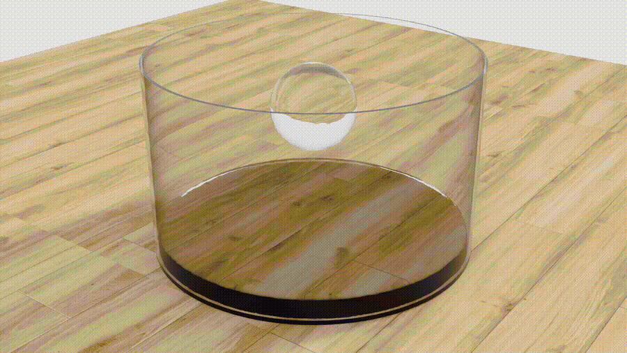
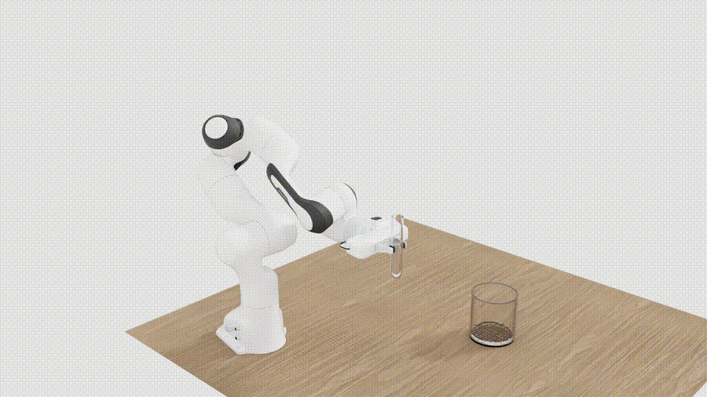

# Isaac Sim Fluid Lab

液滴撞击、水面渲染与 Franka 试管倒水的学习实验。包含可观察的仿真结果、目标水量反馈控制，以及简短的实验记录。


## 实验入口

| 文件 | 内容 |
| --- | --- |
| `droplet_milkcrown_newton_surface.py` | milkcrown 连续水面、透明水材质和桌面切换 |
| `droplet_milkcrown_newton.py` | milkcrown 的隐式 MPM 实现 |
| `robot_testtube_pour.py` | 预握试管→抬起移动→倾倒→扶正；支持实时求解、可选物理缓存回放和 10 秒视频 |
| `robot_target_volume_pour.py` | 手写实时 PBF 反馈基准，选择 20 / 30 / 40 mL 后自动扶正 |
| `robot_target_volume_ai.py` | 支持冻结的 CEM 候选/基准切换，默认使用验证集选定策略 |
| `train_target_volume_policy.py` | 在实时 PBF 中进行 CEM 策略搜索，分开记录训练、验证和独立测试 |
| `train_target_volume_policy_full.py` | 固定 54 训练 + 18 验证 + 18 测试的新种子完整轮，不自动部署 GUI 权重 |
| `robot_target_volume_precision.py` | V2 粗倒、落稳复测与微脉冲补水，保留原基准切换 |
| `train_target_volume_precision.py` | 18 标定 + 12 验证 + 18 独立测试，比较三组预声明精密配置 |

机器人使用预握试管与 IK 运动学控制，液体由求解器计算。原 AI 入口搜索三个停止反馈参数，quick/full 候选均未胜过基准；V2 另用手写粗到细控制与三组有限参数标定，精度提升伴随更长动作时间。两者都不是 PPO、神经网络或六关节端到端控制。没有模拟摩擦抓持、液体反力或力矩反馈。mL 来自固定粒子质量与密度，尚未校准为真实定量实验。

## 动画演示

### 液滴撞击与水冠

对应 [`droplet_milkcrown_newton_surface.py`](droplet_milkcrown_newton_surface.py)，预览来自 `milkcrown_1121.mp4`。

[](docs/demos/milkcrown_1121.gif)

### Franka 试管倒水

对应 [`robot_testtube_pour.py`](robot_testtube_pour.py)，预览来自 `bot_pour_overview.mp4`：预握试管、移动、倾倒并扶正。

[](docs/demos/bot_pour_overview.gif)

## 环境与启动

本次验证环境：Windows、NVIDIA RTX 4090、Isaac Sim **6.2.0-rc.14**、SDK 自带 Python 3.12 与 Newton/Warp。使用 SDK 配套依赖；本项目不附带 Isaac Sim 安装程序，也不通过普通 `pip install` 替换其物理引擎。

在 PowerShell 中设置安装目录，进入本仓库后运行：

```powershell
$env:ISAAC_SIM_ROOT = "C:\omninverse"
& "$env:ISAAC_SIM_ROOT\isaac-sim.bat" --exec "$PWD\launch.py"
```

如果 Isaac Sim 已经打开，在 Window → Script Editor 中运行以下代码。把 `project` 换成仓库的实际路径，以便 Script Editor 的临时缓冲也能正确找到项目：

```python
from pathlib import Path
import sys

project = Path(r"D:\projects\isaac-sim-fluid-lab")
sys.path.insert(0, str(project))
script = project / "robot_target_volume_pour.py"
exec(compile(script.read_text(encoding="utf-8"), str(script), "exec"),
     {"__name__": "__main__", "__file__": str(script)})
```

初始化后，在 **Target volume pouring** 面板选择 **20 / 30 / 40 mL → Play**。Pause 暂停，Reset 复位，Test 20 / 30 / 40 mL 可重新验证三项。文件顶部 `TARGET_VOLUME_ML` 设置初始目标。

`launch.py` 默认启动目标水量基准；环境变量 `ISAAC_FLUID_DEMO` 还可设为 `precision`、`ai`、`pour`、`milkcrown` 或 `bake-cache`。`precision` 使用新的 V2 检查点，面板可切换原基准；`ai` 使用旧 CEM 检查点。启动器会先添加仓库导入路径，避免 Kit 的工作目录与项目目录不同。

## 学习策略与水量显示

目标水量面板默认使用蓝色水流，支持 **Blue water / Clear water** 切换。稀疏水滴以实时求解器的实际空中粒子中心显示，直径为一个粒间距，仅用于观察。新增入杯量、误差、空中余流和流速由仿真粒子测量；目标/实际量导线仅辅助观察等效静态液位，不从透明画面估算 mL。


### 2026-11-22：精密 V2

完成 **18 标定 + 12 验证 + 18 测试，共 48 次实时执行**。九个同初态配对测试条件下，V2 / 原基准 MAE 为 **0.034208 / 0.141264 mL**，最大绝对误差 **0.063125 / 0.340625 mL**；V2 9/9 在 ±0.1 mL 内。平均物理动作时间 **51.04 / 18.91 秒**，更准但更慢。本轮是手工粗倒、落稳复测和微脉冲控制的有限标定，不是 CEM 或神经策略训练。详见[逐目标误差、耗时及 GUI 复验](docs/PRECISION_V2_20261122.md)与[精选数据](results/precision_v2_20261122.json)；旧 quick/full 结果与权重保留。

### 2026-11-22：完整预算轮

完成 **54 个训练、18 个验证、18 个测试回合，共 90 次实时执行**，约 68.2 分钟。三代搜索的最佳参数仍等于初始基准，候选与推荐均为 `is_trained=false`，未找到精度提升。三个新测试种子、九个条件下，候选/基准 MAE 均为 **0.136764 mL**，最大误差 **0.320375 mL**，±0.2 / ±0.5 mL 分别为 **7/9、9/9**。

54 次训练仅复用三个固定初态条件；完整轮与 quick 轮测试种子不同，不能直接按两轮 MAE 判断提升或退步。旧权重与结果保留，新轮权重版本化保存且未自动部署。另做三次 GUI nominal 检查，物理集成均通过；40 mL 误差 −0.254875 mL，未达到现有 ±0.25 mL，精度检查为 2/3 通过。这三次不计入 90 次批量。详见[三代曲线与精简报告](docs/AI_TRAINING_FULL_20261122.md)、[精选逐条件结果](results/ai_training_full_20261122.json)。

### 2026-11-21：快速轮

首轮完成 **18 个训练、6 个验证、18 个测试回合，共 42 次实时液体运行**。测试包含原 12 回合和追加 6 回合候选审计，只有 2 个测试种子、6 个目标×种子条件。独立测试 MAE：默认/基准 **0.082375 mL**，真正训练候选 **0.169313 mL**，未显示改进；两者均有 5/6 条件落在 ±0.2 mL 内。

训练使用原始 1/60 s 物理时间，六次压力迭代，全部回合粒子及实际质量守恒。模型先冻结再测试，追加审计不改变验证集的默认选择。详见[简短结果与真实两代曲线](docs/AI_TRAINING_RESULTS.md)、[精选数据与冻结 SHA](results/ai_training.json)和[复现说明](assets/robot_testtube_pour/AI_TRAINING.md)。

另完成原始逐步调度的三个 GUI 候选 nominal 验证和水流显示检查；它们不计入 42 次批量执行，也不是留出测试。显示的 36 个水滴与实际空中粒子一致，切换蓝水/清水时位置、速度、质量和物理时间完全不变。GUI 默认原始逐步调度；CUDA graph 仅为批量可选加速，需在指定环境验证等价，不能将 headless 等价视为与表面重建交织稳定。10 秒展示视频的时间映射不参与训练。

## 原场景基准结果

以下为原手写反馈基准在同一初始场景的三次 Isaac Sim 实时物理测试；并非新学习策略成绩或跨场景成功率统计。

| 目标 | 最终入杯 | 误差 | 仿真时长 |
| --- | ---: | ---: | ---: |
| 20 mL | 19.936875 mL | −0.063125 mL | 17.82 s |
| 30 mL | 29.755250 mL | −0.244750 mL | 18.85 s |
| 40 mL | 39.745125 mL | −0.254875 mL | 20.02 s |

三次均自动扶正，未检测到洒水；5330 个粒子及总质量不变，复位位置误差为 0。控制器依据已入杯量、预计落杯的空中余流及流速判断停止时机。摘要见 [results/target_volume.json](results/target_volume.json)。

## 缓存、桌面与视频

- 发布版默认 `LIQUID_MODE="simulate"`，直接实时求解。`replay` 需要先生成可选的 `pour_cache.npz`，它不进入 Git 历史。
- 在 Isaac Sim Script Editor 中用上面的加载方式运行 `tools/bake_pour_cache.py`，可重新计算完整物理轨迹并验证、保存缓存；随后把旧倒水入口设为 `LIQUID_MODE="replay"`。
- 回放面板的 **Export 10s MP4** 输出 300 帧、30 FPS、1280×720；需要本机 FFmpeg/FFprobe。视频编码验证后自动清理临时 PNG。
- 默认 `TABLE_STYLE="white_matte"`，不要求下载贴图。`textures/table_options/sources.json` 记录可选桌面贴图的来源及校验和，准备工具见 `tools/prepare_assets.py --help`。
- Franka 转换模型在首次运行时从 SDK 自带 URDF 生成，保存到本地缓存目录。

实时求解的墙钟耗时取决于硬件，面板秒数为仿真时间。回放/视频的剪辑加速不改变训练数据的物理源时间。

## 学习记录与维护

- [简短学习记录](docs/learning_log.md)
- [发布范围与日常更新](docs/PUBLISHING.md)
- [外部依赖与资源来源](THIRD_PARTY_NOTICES.md)

普通 Python 可运行 `python tools/check_release.py` 做源码语法、发布范围与结果摘要检查；它不代替 Isaac Sim GPU 运行验证。
