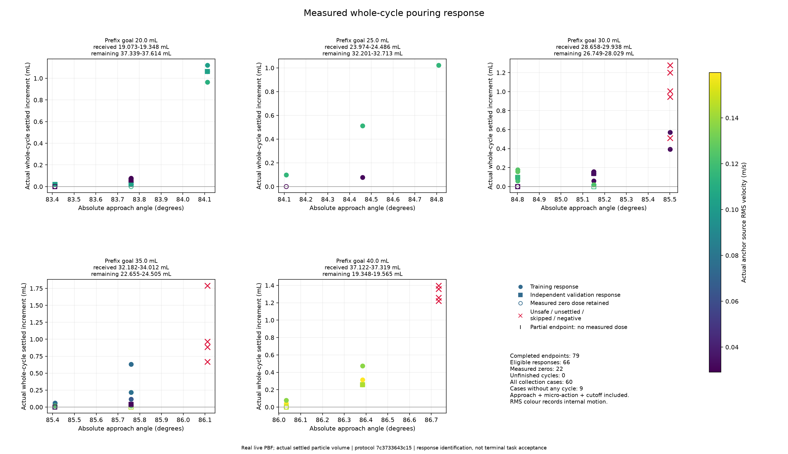
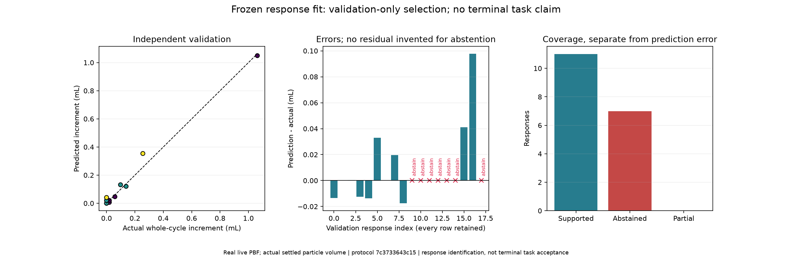
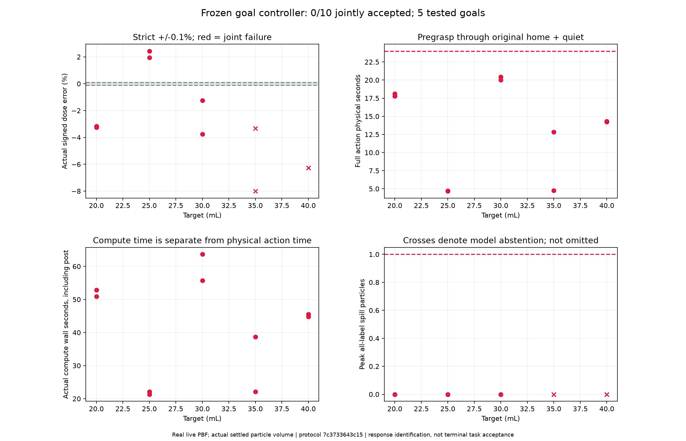

# V12：真实出水响应学习，目标倒水尚未达标

2026-11-27完成60次响应采集、模型拟合和10次新种子开发验收。**目标倒水联合成功0/10**，未启动预留54例范围测试，没有升级GUI默认。所有数字来自[精选结果](../results/adaptive_response_v12_20261127.json)，审计通过只证明记录、运动与计量一致，不代表剂量达标。

## 本轮真正学了什么

沿用原实时PBF、2.7mm粒距与运动路径；无回放、倍速或粒子质量调整。每粒0.019683mL，源水56.68704mL。保持24原始物理秒内完整回原位并稳定、目标±0.1%、全标签洒水峰值≤1粒；额外2秒观察只能否定晚滴。

先从真实预握执行粗倒，再采集“78°实际落稳→接近出水角→小动作→回撤→78°实际落稳”的**完整周期**。首次工程例表明接近过程已倒出1.161297mL，后续微动作却增加0mL，因此只学微动作会漏算主要水量。

60例为45训练、15验证，覆盖20/25/30/35/40mL上下文和三档接近角；三个训练种子与一个验证种子分离。得到79个完整测量周期：66个可拟合、22个零增量、13个微动作分支未完整执行，无截断周期；零增量与风险分支全部保留。9例在粗倒时已超过25mL，未开始补水，仍计入全部结果。采集仅2/60联合达标，**它们是探索动作，不是冻结策略测试**。洒水为51例0粒、9例1粒，全部在约定范围内。

模型是带局部支持检查的经验响应模型，不是PPO或神经网络。输入包括实际水量、源水余量、倾角、源粒内部速度RMS和重心高度，以及接近、保持、回撤等11个动作参数；输出完整周期的落稳增量、耗时和经验风险。验证仅选择邻域半径，冻结后才运行新种子控制；不支持的状态拒绝动作，最终停止仍依靠真实落稳复测。

选定半径0.75；18个验证周期中仅11个获得预测、7个拒绝。**只在这11个受支持周期上**，预测MAE为0.022625mL，最差0.097753mL；这不是18例整体精度，更不是最终倒水误差。检查点SHA为 `1d2ec1fa468f33ac0161307cc0c83bcd289b7fb775fb1f28cbdab942687ec8d0`。

## 冻结模型的新种子开发验收

每目标两个新种子。全部在24秒内回位、零洒水、无晚滴，但十例均未过剂量门槛；35/40mL共四例出现模型拒绝动作。墙钟包含额外2秒观察，不等于动作物理时间。

| 目标 | 允许误差 | MAE（mL） | 最差误差（mL） | 平均物理动作（s） | 平均计算墙钟（s） | 联合成功 |
| --- | --- | --- | --- | --- | --- | --- |
| 20mL | ±0.020mL | 0.641769 | 0.651611 | 17.933 | 51.881 | 0/2 |
| 25mL | ±0.025mL | 0.548534 | 0.607583 | 4.700 | 21.712 | 0/2 |
| 30mL | ±0.030mL | 0.751062 | 1.125039 | 20.225 | 59.663 | 0/2 |
| 35mL | ±0.035mL | 1.981767 | 2.798612 | 8.783 | 30.388 | 0/2 |
| 40mL | ±0.040mL | 2.503885 | 2.503885 | 14.275 | 45.173 | 0/2 |

## 失败边界与后续

- 25mL在粗倒阶段已过量，补水模型无法取回水；该上下文仅一个训练种子有响应，验证没有响应。
- 35mL粗倒后的实际水量与内部波动差异较大，存在训练支持缺口；放宽邻域会把风险动作一同纳入，不能用它包装覆盖成功。
- 40mL粗倒仍少约2.5–2.8mL；安全周期补量有限，完整第二周期的保守回家预算放不进24秒。较高角度常无法完成预定微动作。

## 追加12例粗倒前段标定

另开协议，仅改变粗倒控制信号的mL偏移，实际目标、速度、物理、计量和验收均不变；到首次78°落稳便直接回家，不执行补水或模型动作。两个新开发种子、六个条件全部完成并通过独立审计；物理动作4.683–4.883秒、10例0粒洒水和2例1粒，无晚滴。**严格剂量0/12**；这批用于测量前段响应，不是新的精密策略或留出测试。[完整精选记录](../results/prefix_calibration_v13_20261127.json)。

| 实际目标 | 内部控制目标偏移（mL） | 两个种子的实际入杯量（mL） |
| --- | --- | --- |
| 25mL | −0.5 | 25.489485 / 23.993577 |
| 25mL | −1.0 | 23.855796 / 23.993577 |
| 35mL | 0 | 33.874443 / 34.031907 |
| 35mL | +0.5 | 33.874443 / 34.031907 |
| 40mL | +1.0 | 37.200870 / 37.279602 |
| 40mL | +1.5 | 38.834559 / 39.031389 |

25mL的−0.5偏移仍有一例过量，−1.0两例均欠量；35mL两个偏移结果相同，显示当前控制/流动的离散响应；40mL的+1.5减小了欠量，但仍少约0.97–1.17mL。它们只提供下一步受约束补水的起点证据，没有训练或部署新模型。预留54例、未见小数目标及GUI升级仍未放行；进一步控制修改须另开协议。

本轮用Isaac Sim SDK环境的实时求解进行无渲染采集与验收。量取特权粒子质量/密度真值，机器人为运动学预握；它不证明实秤、力觉、真实抓持或任意连续mL的精度。
