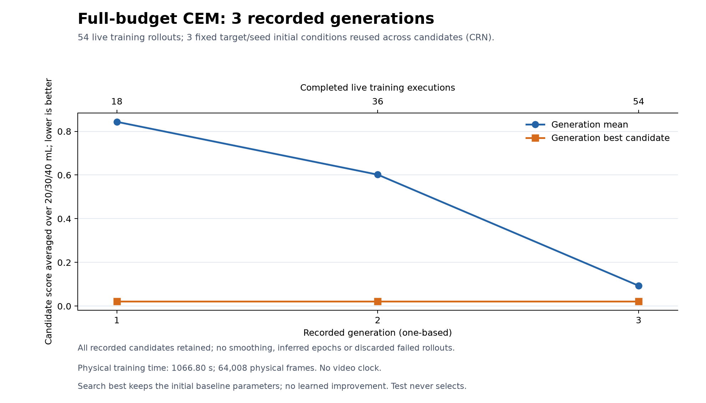
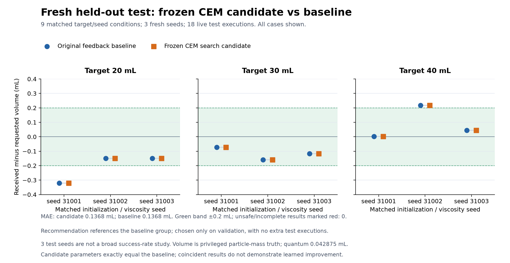
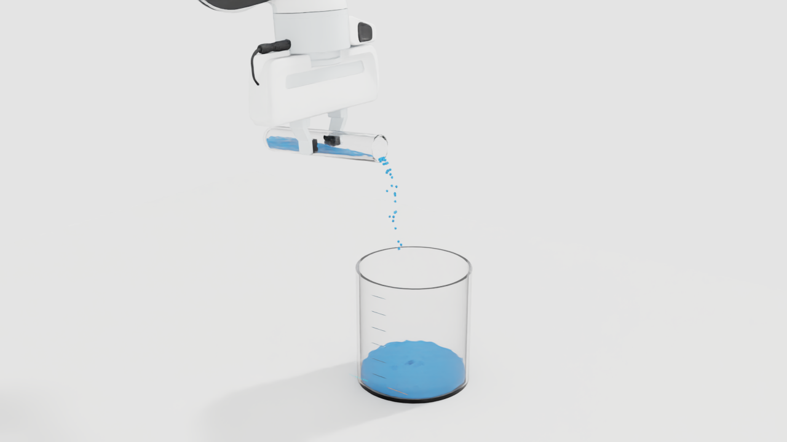

# 2026-11-22：完整预算倒水策略搜索

完成 **54 个训练、18 个验证、18 个测试回合，共 90 次实时液体执行**，运行约 **68.2 分钟**（4092.94 s）。CEM 为三代、每代六个候选；54 次训练复用三个固定目标×种子初态，并非 54 个独立场景。

最佳参数仍为初始基准 `bias=0.2 mL / lead=0.2 s / slope=0`。搜索没有找到更优参数，候选与推荐均如实记录 `is_trained=false`，验证推荐 `baseline_fallback`。没有部署新 GUI 权重。

| 新留出测试 | MAE (mL) | 最大误差 (mL) | ±0.2 mL | ±0.5 mL |
| --- | ---: | ---: | ---: | ---: |
| 冻结候选 / 基准 | 0.136764 | 0.320375 | 7/9 | 9/9 |

候选、基准各执行九回合，覆盖九个目标×种子条件、三个新种子。推荐测试指标引用基准组，不额外执行，也不依据测试更换推荐。与 quick 轮测试种子不同，不能直接按两轮 MAE 判断提升或退步。





完整性审计核对 90 份轨迹 SHA、104,960 行状态记录（含每回合初态）与 104,870 次更新，质量漂移为 0，八源码和原七源码检查通过。按采集时 ±0.25 mL 阈值，33 次精度验收未通过（训练29、验证2、测试2），均保留；物理无效回合为0。审计不重放 GPU，逐粒子数组未写入原始日志。

训练保留 64,008 物理帧、1066.8 s；全轮 104,870 帧、1747.833 s。固定 dt=1/60 s、原自适应子步与六次压力迭代；无洒水，5330 粒子、实际质量数组与质量守恒，所有状态有限。mL 为粒子质量/密度真值，量化 0.042875 mL，尚无光学量水或真机校准。

## 额外 GUI nominal 检查

显式载入本轮推荐检查点（SHA `857f8813…ddac357`），在原场景使用逐步调度，未重建 stage、未替换默认资产权重。这三次额外 GUI 执行不计入 90 次批量，也不是留出测试。

| 目标 | 实际新增 (mL) | 误差 (mL) | 现有 ±0.25 mL |
| ---: | ---: | ---: | --- |
| 20 | 19.936875 | −0.063125 | 通过 |
| 30 | 29.755250 | −0.244750 | 通过 |
| 40 | 39.745125 | −0.254875 | 未通过 |

三次物理集成均完成：扶正、空中余流归零、质量与夹持跟踪检查通过；40 mL 的精度失败保留，阈值没有放宽。



旧 [2026-11-21 GUI 证据](AI_TRAINING_RESULTS.md)、quick 权重与结果均保留，新轮两份 JSON 使用版本名。验证脚本、报告和新图的 SHA 记录在精选 JSON 中。

复现时从仓库根目录设置 SDK 安装目录，使用新输出目录：

```powershell
$env:ISAAC_SIM_ROOT = "D:\apps\isaac-sim"
& "$env:ISAAC_SIM_ROOT\kit\python\python.exe" "$PWD\train_target_volume_policy_full.py" --graph --output "$PWD\droplet_out\pour_policy_training\my_full_run"
```

完整结束后可用 `tools/training/plot_full_results.py RUN_DIRECTORY` 重画；源码变更会改变协议 SHA，不能将原本机日志作为公开副本的续跑状态。精选逐条件结果、种子与冻结 SHA 见 [ai_training_full_20261122.json](../results/ai_training_full_20261122.json)。
