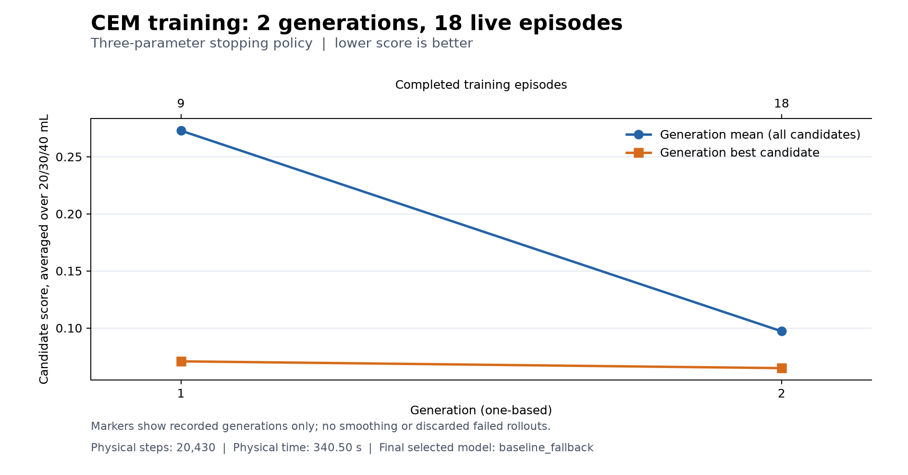
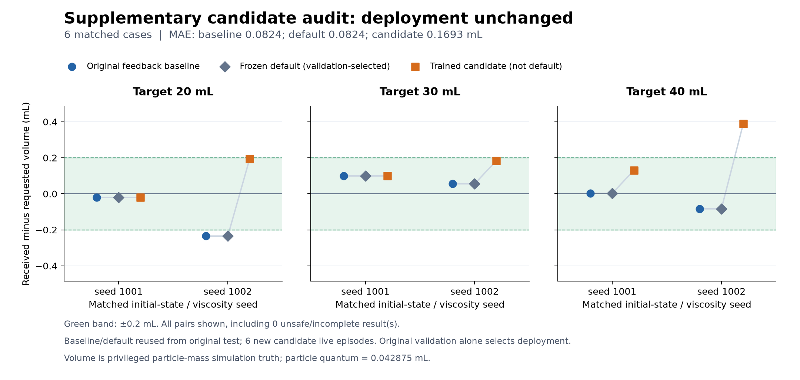
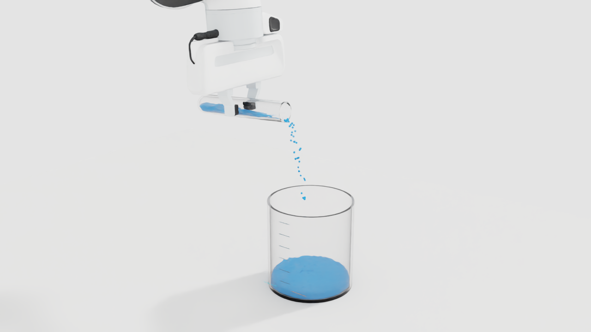

# 2026-11-21：目标水量策略训练

完成 **18 个训练、6 个验证、18 个测试回合，共 42 次实时液体运行**。测试含原 12 回合与追加的 6 回合候选审计；仅有 2 个测试种子、6 个目标×种子条件。

CEM 搜索三个停止/扶正参数。验证 MAE：基准 **0.061333 mL**，训练候选 **0.112542 mL**，因此默认冻结为 `baseline_fallback`（`is_trained=false`）；候选保留为实验切换选项。追加审计不改变模型选择。

| 独立测试 | MAE (mL) | 最大误差 (mL) | ±0.2 mL | ±0.5 mL |
| --- | ---: | ---: | ---: | ---: |
| 默认/原基准 | 0.082375 | 0.234625 | 5/6 | 6/6 |
| 真正训练候选 | 0.169313 | 0.388250 | 5/6 | 6/6 |

本轮候选未胜过基准。每回合均保持 5330 粒子及实际质量数组不变，完成扶正，无洒水。物理步长 1/60 s，六次压力迭代；18 个训练回合共 20,430 帧、340.5 s 物理时间。展示视频加速未参与训练。

另有原始逐步调度的 GUI 候选 nominal 验证：20/30/40 mL → 20.108375/29.969625/40.002375 mL，质量与夹持跟踪检查通过。这三个回合不计入 42 次批量执行，也不是留出测试。

水流显示检查通过：36 个标记与实际试管来源的空中粒子中心一致，直径为一个粒间距，仅显示、无额外碰撞，未插值补成连续水柱。蓝水/清水切换时，粒子位置、速度、质量和物理时间完全不变；清水模式隐藏这些标记。数字 mL 继续由质量/密度计算，并非光学量水。图中为倒水中途状态。

数值来自粒子质量/密度，分辨率 0.042875 mL，尚无视觉估水或真机称重校准；预握和机械臂路径仍为运动学控制。GUI 默认原始逐步调度；CUDA graph 仅为批量可选加速，需在指定环境先验证等价，不能据 headless 等价假定表面重建交织稳定。

精选逐条件结果、种子、版本和冻结 SHA 见 [ai_training.json](../results/ai_training.json)；复现步骤见 [AI_TRAINING.md](../assets/robot_testtube_pour/AI_TRAINING.md)。原始逐帧日志留在本地。
