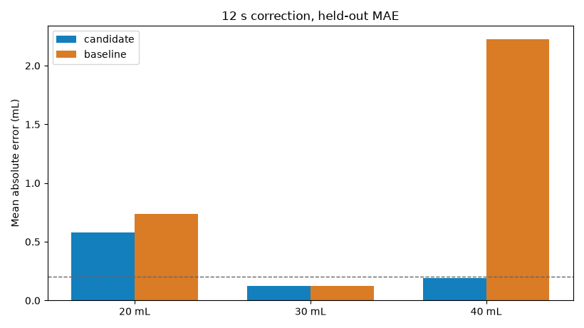

# 12 秒补水：六个留出条件进了 ±0.2 mL

10 秒试点没有同时满足剂量和回家，所以同一套补水放到 **12 秒**。正式结果是 **6 次 10 秒试点 + 6 次 12 秒试点 + 12 验证 + 18 测试，共 42 次实时 PBF**。粗倒仍用固定嘴抬升路径，倾角 25.6°/s、停止提前 10 mL。78° 落稳后，若还少 0.2 mL 以上，就用 2.5°/s 再补一到两次，然后回家。这是精密 V2 的「先少倒、落稳、再补」结构，不是再搜三个停止参数，也不是神经网络。

验证集候选/不补水基准 MAE **0.176063 / 1.206458 mL**，±0.2 mL 为 4/6 对 0/6，推荐是候选。测试没有参与选择。九个新种子上候选/不补水基准 MAE 为 **0.298069 / 1.030125 mL**，最大误差 **0.965875 / 2.227125 mL**，±0.2 mL 为 **6/9 对 3/9**。九例都在 12 秒内回家。候选有 1 例 40 mL 洒出 1 颗粒子。未替换 GUI 默认。

| 目标 | 策略 | MAE(mL) | 最大绝对误差(mL) | 平均有符号误差(mL) | 物理动作(s) | 动作+后观察墙钟(s) |
| --- | --- | ---: | ---: | ---: | ---: | ---: |
| 20 | 补水 | 0.579208 | 0.965875 | +0.451375 | 5.7333 | 14.63 |
| 20 | 不补水 | 0.736417 | 0.965875 | +0.294167 | 4.4889 | 13.14 |
| 30 | 补水 | 0.126833 | 0.184000 | +0.126833 | 4.6056 | 13.87 |
| 30 | 不补水 | 0.126833 | 0.184000 | +0.126833 | 4.6056 | 13.79 |
| 40 | 补水 | 0.188167 | 0.302500 | +0.188167 | 9.7944 | 25.56 |
| 40 | 不补水 | 2.227125 | 2.227125 | −2.227125 | 4.7222 | 16.07 |

种子是 113101/113102/113103。30 mL 三例都在 ±0.2 mL 内，而且和粗倒相同，因为粗倒已经够近，没有再补。40 mL 不补水时三例都少 2.227 mL，补水后变成 +0.174 / +0.303 / +0.088。20 mL 有两例粗倒已经多倒，补水加不回去。逐例见[精选数据](../results/correction_12s_20261123.json)。

补水只能加液体。粗倒一旦超过目标，多出来的时间没有用。精密 V2 用约 51 秒、预留后逐粒补水，九例都进了 ±0.1 mL；这一轮平均 6.71 秒，留出测试 6/9 进 ±0.2 mL，还不是那一档。粒子量化 0.042875 mL。42 次墙钟约 721 秒（12.0 分钟）。

