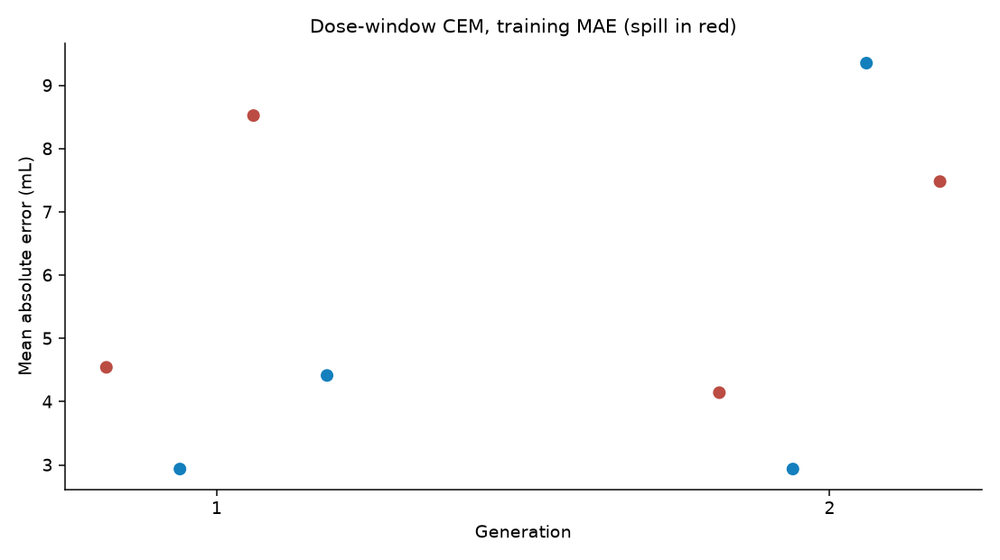
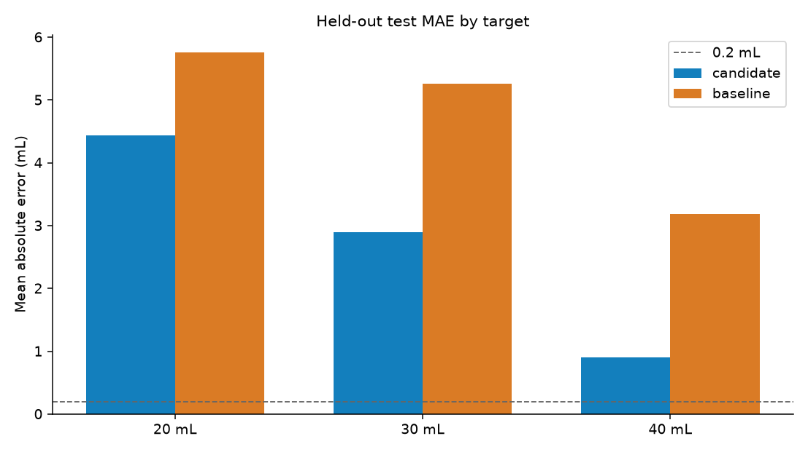
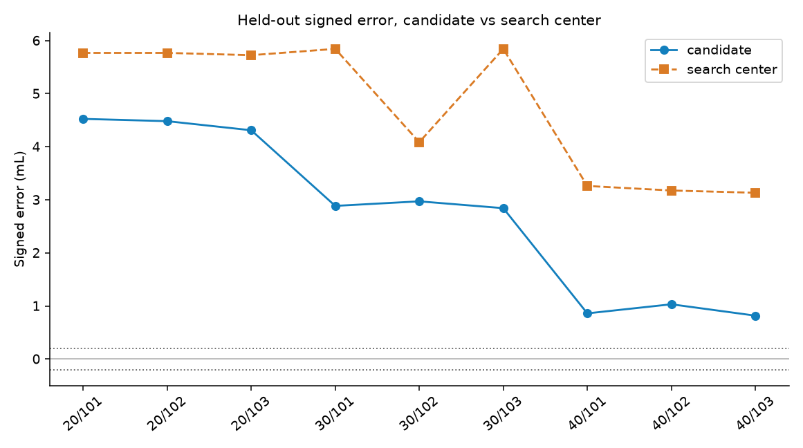

# 剂量窗口 V6：计量仍未通过

完成 **6次否决试点 + 48训练 + 12验证 + 18测试，共84次实时PBF执行**。路径仍是V4的竖直抬高25mm再固定嘴口，截止时间仍是5.0物理秒。只搜索倾倒角速度、停止提前量和余流提前时间；准备比例、返回比例和剂量加速度保持1.0、1.0、6.0。验证集选定推荐，冻结后才跑三个新测试种子。

40°/s、停止提前1mL的试点点被否决，不作为搜索中心，也不作为本轮基准。六个试点全部超量11–23mL，其中两例各洒出1颗粒子。控制器的停止提前量上限是10mL，所以搜索放在22–40°/s、提前量2–10mL、余流提前0.08–0.28s，中心是28°/s、8mL、0.18s。本轮基准就是这个中心，不是V4候选，也不是被否决的试点点。

候选/搜索中心在九个同种子测试上的MAE为 **2.746972 / 4.733514 mL**，最大误差 **4.524500 / 5.843500 mL**。双方九例全部超量，**±0.2mL均0/9**。验证集也是候选MAE更小（2.685042对4.893104mL），所以推荐角色是候选；测试没有参与选择。误差变小不代表定量倒水成功，未替换GUI默认。

| 目标 | 策略 | MAE(mL) | 最大绝对误差(mL) | 平均有符号误差(mL) | 物理动作(s) | 动作+后观察墙钟(s) |
| --- | --- | ---: | ---: | ---: | ---: | ---: |
| 20 | 候选 | 4.438750 | 4.524500 | +4.438750 | 4.4833 | 12.91 |
| 20 | 搜索中心 | 5.753583 | 5.767875 | +5.753583 | 4.5000 | 13.02 |
| 30 | 候选 | 2.899417 | 2.970875 | +2.899417 | 4.6111 | 15.31 |
| 30 | 搜索中心 | 5.257542 | 5.843500 | +5.257542 | 4.6111 | 13.90 |
| 40 | 候选 | 0.902750 | 1.031375 | +0.902750 | 4.6611 | 14.80 |
| 40 | 搜索中心 | 3.189417 | 3.260875 | +3.189417 | 4.6889 | 15.84 |

每行三个相同种子104101/104102/104103，逐例有符号误差见[精选数据](../results/dose_window_20261123.json)。18次测试都在5物理秒内回家。候选测试有2例各洒出1颗粒子，搜索中心有1例洒出1颗；其余为零spill。观察到第7秒的入杯量变化都是0，失败来自超量，不是第5秒之后又滴进杯子。

评分用V5：每例绝对误差≤0.2mL、全部标签零spill、完整回家≤5物理秒，整组才算可行；不可行时只比平均绝对误差，再比总spill。没有MAE≤0.1的附加门槛，也没有用这套规则重选V4。两组测试都不可行，候选只是超量更少。

本轮测试种子与V3、V4、精密V2都不重合，不能拿2.747mL去和V4的1.726mL比高低。V4候选是欠量，这一轮候选是超量。粒子体积量化0.042875mL，mL来自仿真粒子质量，不是秤。没有夹持力矩。关节加速度沿用仿真包络。84次动作与后观察墙钟约1557秒（26.0分钟），墙钟随机器负载变化。

这是失败研究归档，不是新的GUI默认，也不是不带本机几何缓存就能重跑的入口。

