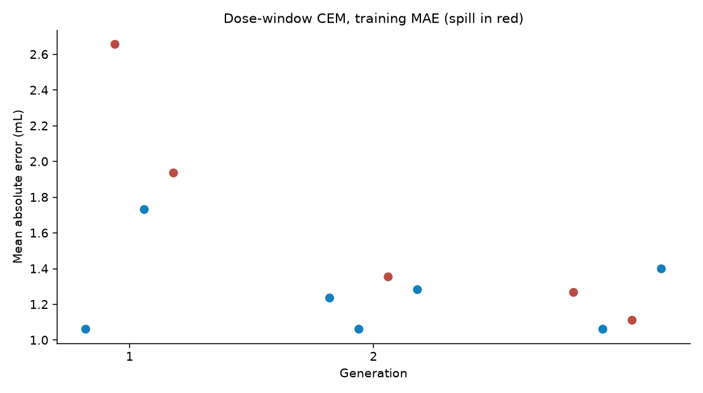
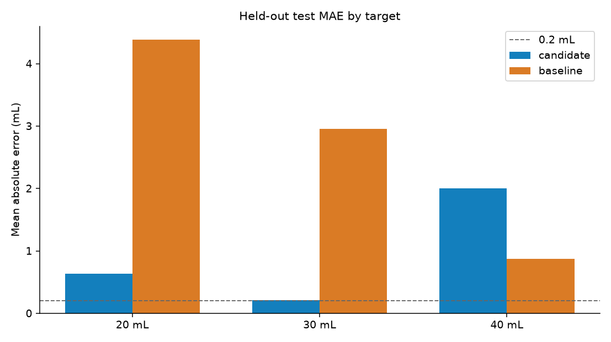
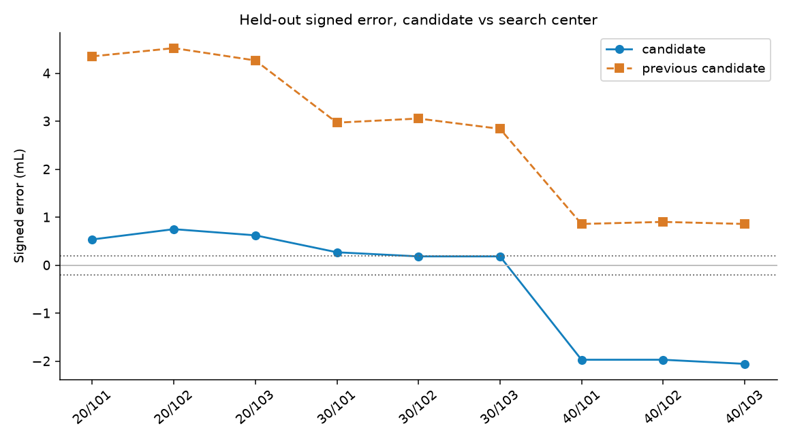

# 剂量窗口续训：40 mL 仍少约 2 mL

完成 **6次试点 + 72训练 + 12验证 + 18测试，共108次实时PBF执行**。路径、5秒截止和三个冻结参数都没变。搜索只放在上一轮超量和V4欠量之间：倾角24.5–29°/s，停止提前量8–10mL，余流提前0.18–0.28s。中心是26.2°/s、9.5mL、0.23s。基准是上一轮已发布的候选，在这批新种子上重跑，不用旧测试重选。

试点没有改中心。20mL大约多0.64mL，30mL大约多0.21mL，40mL大约少2.0mL，六例都回家、零spill。之后三代、每代4个候选，训练上没有一个样本胜过这个手定中心，所以候选参数就是中心本身。验证集MAE **1.218563 / 2.963729 mL**，推荐仍是候选。测试没有参与选择。

候选/上一轮候选在九个新种子上的MAE为 **0.949403 / 2.737444 mL**，最大误差 **2.055625 / 4.524500 mL**。±0.2mL 为 **2/9 对 0/9**。两例达标都是30mL。20mL仍全部多倒，40mL仍全部少倒。误差下降不代表定量任务成功，未替换GUI默认。

| 目标 | 策略 | MAE(mL) | 最大绝对误差(mL) | 平均有符号误差(mL) | 物理动作(s) | 动作+后观察墙钟(s) |
| --- | --- | ---: | ---: | ---: | ---: | ---: |
| 20 | 候选 | 0.637167 | 0.751500 | +0.637167 | 4.4944 | 14.01 |
| 20 | 上一轮候选 | 4.381583 | 4.524500 | +4.381583 | 4.5000 | 14.14 |
| 30 | 候选 | 0.212583 | 0.269750 | +0.212583 | 4.5778 | 14.81 |
| 30 | 上一轮候选 | 2.956583 | 3.056625 | +2.956583 | 4.5833 | 14.86 |
| 40 | 候选 | 1.998458 | 2.055625 | −1.998458 | 4.7444 | 17.58 |
| 40 | 上一轮候选 | 0.874167 | 0.902750 | +0.874167 | 4.6722 | 15.81 |

每行三个种子110101/110102/110103，逐例有符号误差见[精选数据](../results/dose_window_v7_20261123.json)。18次测试都在5物理秒内回家。候选的40mL、种子110102洒出1颗粒子；上一轮候选这九例零spill。第5秒到第7秒的入杯量变化都是0。

同一组参数把20mL配准时，40mL会少约2mL；把40mL补上时，20mL又会多倒。三代搜索没有在这个区间里找到九例同时≤0.2mL的点。评分仍是V5，没有MAE≤0.1的附加门槛，也没有重选更早的轮次。

测试种子与剂量窗口首轮、V4、V3、精密V2都不重合。粒子体积量化0.042875mL，mL来自仿真粒子质量。没有夹持力矩。进程墙钟约1906秒（31.8分钟）。

这是失败研究归档，不是新的GUI默认，也不是不带本机几何缓存就能重跑的入口。

