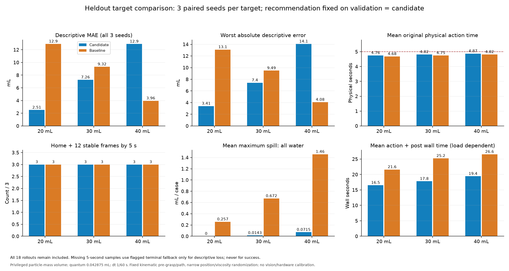
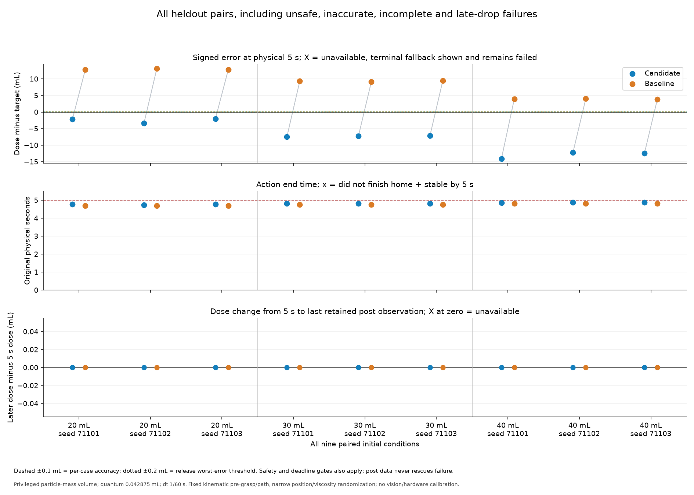
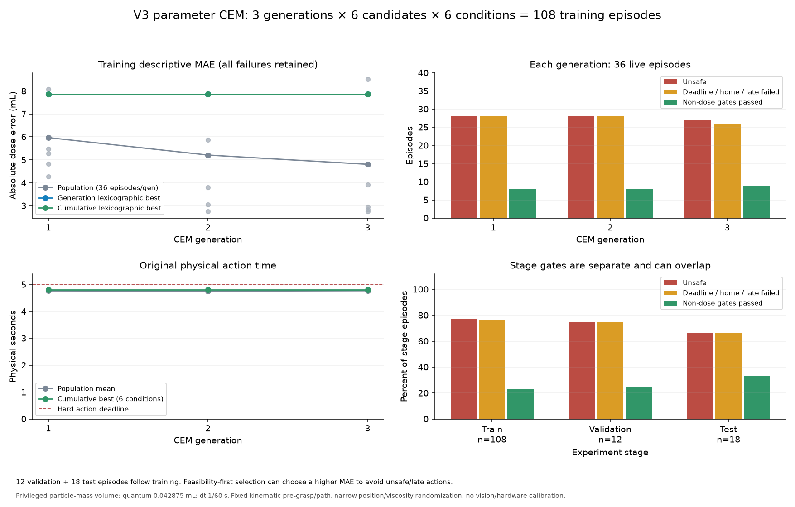

# 5 秒倒水 V3：2026-11-22

完成 **108 训练 + 12 验证 + 18 独立测试 = 138 次实时液体执行**，墙钟约62.65分钟。六参数CEM搜索速度与停止时机；**完整实验已结束，定量任务未成功**。

候选/初始V3基准的九例测试 MAE **7.557319 / 8.730417 mL**，最大误差 **14.060625 / 13.099500 mL**；两者 ±0.1 与 ±0.2 mL 都是 **0/9**。候选九例全部欠量，40 mL 的 MAE 从基准3.961增至12.903 mL，不能用总体MAE下降掩盖退步。

## 逐目标：同初态配对的三个新种子

每行三例。溢出为每例峰值的均值，计入所有初始标签的水；墙钟包含动作及后续观察，受机器负载影响。

| 目标mL / 策略 | MAE mL | 最大误差 mL | 平均动作秒 | 动作+观察墙秒 | 平均溢出mL/例 | 5秒home |
| --- | ---: | ---: | ---: | ---: | ---: | ---: |
| 20 / 候选 | 2.507000 | 3.407375 | 4.756 | 16.53 | 0.000000 | 3/3 |
| 20 / 初始基准 | 12.913708 | 13.099500 | 4.683 | 21.62 | 0.257250 | 3/3 |
| 30 / 候选 | 7.261958 | 7.404875 | 4.817 | 17.80 | 0.014292 | 3/3 |
| 30 / 初始基准 | 9.316375 | 9.487875 | 4.750 | 25.23 | 0.671708 | 3/3 |
| 40 / 候选 | 12.903000 | 14.060625 | 4.872 | 19.43 | 0.071458 | 3/3 |
| 40 / 初始基准 | 3.961167 | 4.075500 | 4.817 | 26.55 | 1.457750 | 3/3 |

全部九组有符号误差及原assessment保存在[精选数据](../results/fast_v3_20261122.json)。推荐候选仅由验证集决定；冻结后才测试，测试不改参数或推荐。candidate/recommended是研究快照角色，不表示验收通过，未新增GUI默认部署。

## 五秒达到了什么

完整周期从预握初态计时，包含抬起、移动、倾倒、扶正、返回原位和连续12帧稳定。138次动作均在4.617–4.967物理秒完成；随后继续原求解器观察至第7秒，动作657.9秒、观察308.1秒另计。

138次原始数值有效、质量守恒且关节约束通过；严格任务门槛仍有104次溢出失败，其中103次涉及试管源水。所有回合的后续受水量变化为0，103个late门槛失败来自已有源水溢出，**不是超时或5秒后继续滴水**。独立测试候选3/9溢出、基准9/9溢出；候选6例虽满足非精度门槛，水量仍不合格。

## 搜索与边界

3代×6候选×6训练条件，共108次执行、16组不同参数；按数值/溢出、deadline/home/late、精度违反量、MAE、动作时间依次选优。第一代找到的lex最优在后两代未改变。较大余流提前量与本轮欠量相符，因果仍需另开训练数据验证。

训练种子61101/61102，验证62101/62102，留出71101/71102/71103。关节导数231840个240Hz样本、FK/TCP 58098个60Hz端点、20份源码与全部日志/输入SHA通过独立审计。关节加速度25 rad/s²是仿真包络，不是厂家硬件额定值。

水量是0.042875 mL量子的特权粒子真值；运动学预握未验证摩擦抓持/驱动转矩/碰撞安全，初始位置仅0.03粒间距微扰、黏度±10%、三条留出种子，不能据此宣称真机计量精度。

机器人路径NPZ仅保存关节/几何缓存，**不是液体回放**。公开版从明确暂停且由当前demo持有的场景导出关节bank，再prepare_fast_path→prepare_smooth_fast_path→verify_fast_path；CPU准备需NumPy，绘图另需Matplotlib。重建缓存受SDK/bank/NumPy影响，不保证原SHA；须核对当前geometry源码哈希，显式设置新的小写ISAAC_FAST_PATH_CACHE_SHA256，并生成新工程报告与协议，不能续跑原始本机日志。原canonical协议未全文公开；精选protocol_summary去掉私人路径，其哈希不等于保留的原protocol_id。

下一条direct路线另开实验；本记录只纳入其CPU准备状态，没有该路线的液体实测改进结论。旧quick/full/V2结果、模型和GUI入口保留。
