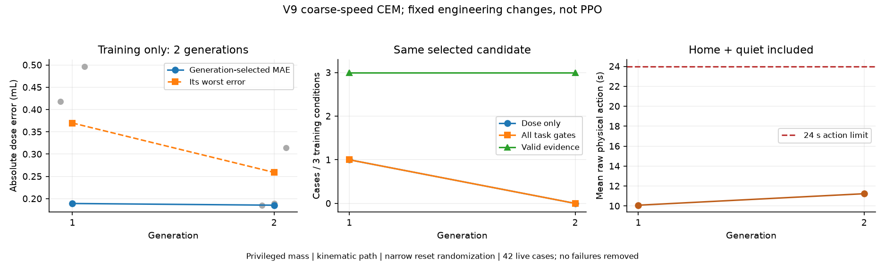
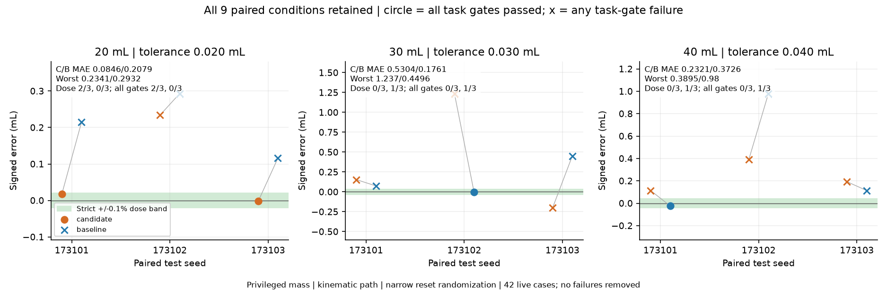
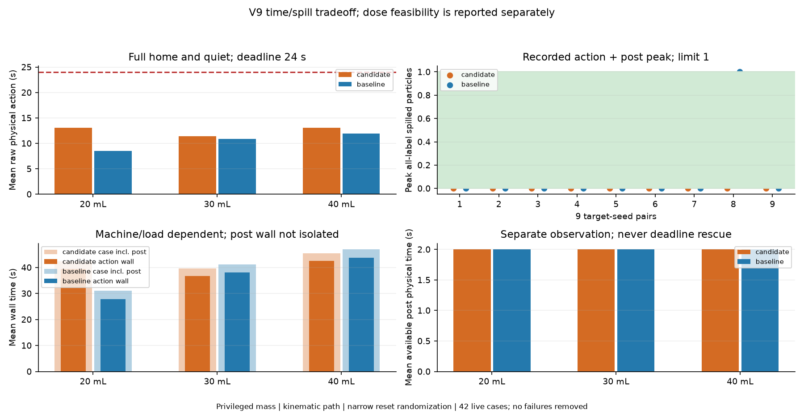

# 2026-11-27：细粒子 V9，42 回合未通过精度验收

18 训练、6 验证、18 独立对照测试全部完成，并通过原始记录及运动计量审计。验证集选择保留同分辨率旧基准；候选总体没有提升，未部署新 GUI 默认。下表每目标、每策略各三个相同初态种子，全部失败均计入。

| 目标 / 容差 | 策略 | MAE / 最坏误差（mL） | 达标 | 动作物理均时（s） | 计算墙钟均时（s） |
| --- | --- | ---: | ---: | ---: | ---: |
| 20 / ±0.020 mL | 候选 | 0.084602 / 0.234124 | 2/3 | 13.106 | 42.434 |
| 20 / ±0.020 mL | 基准 | 0.207880 / 0.293173 | 0/3 | 8.489 | 31.017 |
| 30 / ±0.030 mL | 候选 | 0.530405 / 1.236921 | 0/3 | 11.372 | 39.684 |
| 30 / ±0.030 mL | 基准 | 0.176111 / 0.449601 | 1/3 | 10.861 | 41.222 |
| 40 / ±0.040 mL | 候选 | 0.232052 / 0.389516 | 0/3 | 13.044 | 45.516 |
| 40 / ±0.040 mL | 基准 | 0.372596 / 0.980006 | 1/3 | 11.922 | 46.943 |

达标同时要求严格目标量的 ±0.1%、全部标签洒水峰值 ≤1 粒、24 秒内返回原预握位置并稳定 12 帧，以及后观察无迟到水量变化。动作时间包含全部移动、落稳复测及回位；墙钟包含动作、额外 2 物理秒观察和重置等开销，受机器负载影响。额外观察的墙钟没有单独计时，不由差值冒充实测。

候选与基准整体 MAE 为 0.282353 / 0.252196 mL，均仅 2/9 达标；平均动作 12.507 / 10.424 秒。两组九例均在 24 秒内完整回家且没有晚滴；候选测试洒水峰值为 0，基准为 1 粒。时间和洒水合格不能替代剂量精度。

## 本轮实际改变

- 实时 PBF，60 Hz、六次压力迭代、自适应子步、CUDA graph 关闭。粒距固定 2.7 mm，每粒 0.019683 mL；总 11625 粒、源水 2880 粒即 56.68704 mL。两策略使用同一初态分布，不与旧 3.5 mm 试验混算。
- 候选固定修正微探回倾速度至 6°/s、连续 0.2 秒稳定复测、主补水预留 0.15 mL；CEM 仅搜索粗倒速度乘数。两代六个候选，其中五种不同速度；18 次训练来自三个固定目标及一个共同种子，不是神经网络训练或纯打分消融。
- 训练选出乘数 0.9972855433（粗倒 25.530510°/s）；验证 MAE 候选 0.308712、基准 0.147795，故冻结推荐为基准。两个模型先冻结再运行九对独立测试，测试没有重选模型。

## 失败原因与边界

仅从训练/验证轨迹诊断：微补入口只接受欠量 ≤0.15 mL，普通补水要求欠量 >0.2 mL，中间存在控制死区。一个训练 30 mL 案例微倾期间有粒子离管后重入，到角度上限时净出管数仍未增加，随后回倾新增 61 粒（1.200663 mL）；当前管外净数不能当作累计离管事件。验证 40 mL 的单粒触发后又新增 36 粒（0.708588 mL），说明加快回倾仍不等于关闭阀门。仅搜索粗倒速度不能修复这些分支；主要瓶颈不是耗尽 24 秒。

当前计量读取固定粒子质量/密度与实际求解器姿态，并非机械臂称重或视觉测量；运动学预握、采样的关节速度及 25 rad/s² 仿真加速度包络不能代替真机抓持、力矩或连续碰撞认证。只验证 20/30/40 mL、一个验证种子及三个测试种子，尚无任意小数水量的泛化证据。后续结构改进和未训练目标验证须使用新协议、新种子，不能重用本轮已见测试调参。

[全部 42 条精选结果及九对有符号对照](../results/fine_v9_20261127.json)保留原 footer 和独立的新任务评估；旧 `success` 不冒充严格百分比通过。[版本化研究源码](../research/fine_particle_v9_20261127/README.md)保留原始来源 SHA，公开 `robot.py` 仅转换本机路径并单列派生 SHA，不可续用原日志。原始逐步记录、NPZ、SDK 与第三方模型留在本地。

