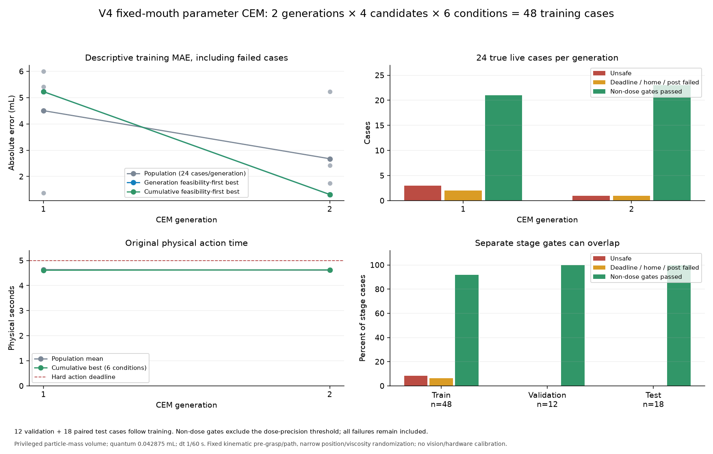
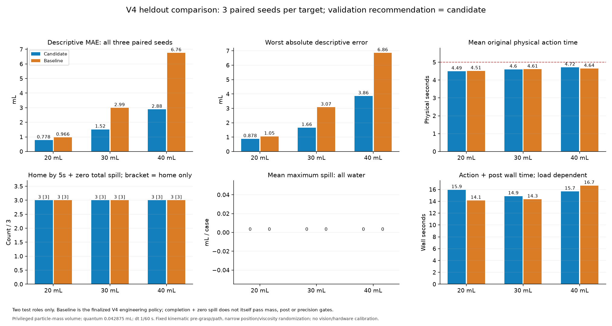
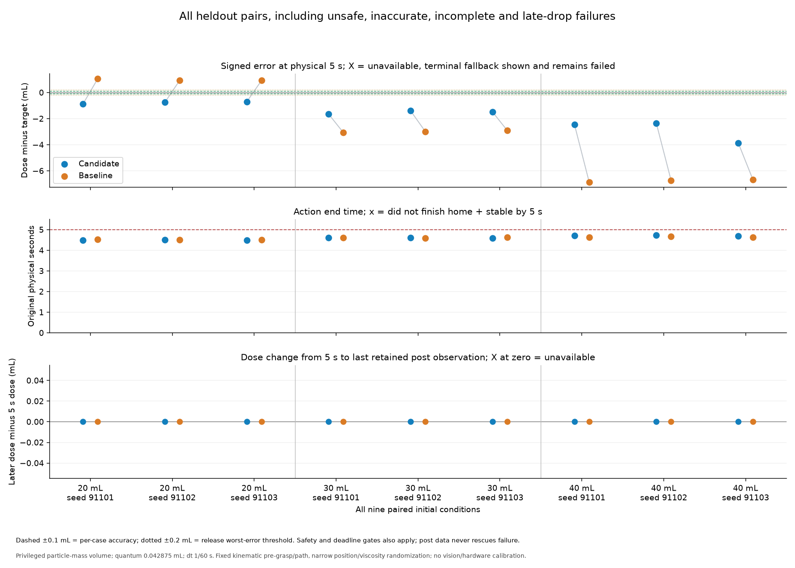

# 五秒固定嘴倒水 V4：计量仍未通过

完成 **48训练 + 12验证 + 18测试，共78次实时PBF执行**。先竖直抬高25mm，再在杯上方固定嘴口倾倒，使用完整三维姿态计量；78°落稳后沿原轨迹返回。六参数CEM在训练集选候选、验证集选推荐，冻结后才执行三个新种子、九个同初态配对测试条件。

候选/初始V4基准测试MAE为 **1.726319 / 3.570736 mL**，最大误差 **3.856375 / 6.857625 mL**。候选九例全部欠量，双方 **±0.2mL均0/9**。误差减小不代表定量倒水任务成功，三项原验收标记均为false，未替换GUI默认，也没有新增GUI验收。

| 目标 | 策略 | MAE(mL) | 最大绝对误差(mL) | 平均有符号误差(mL) | 物理动作(s) | 动作+后观察墙钟(s) |
| --- | --- | ---: | ---: | ---: | ---: | ---: |
| 20 | 候选 | 0.777708 | 0.877750 | −0.777708 | 4.4944 | 15.94 |
| 20 | 基准 | 0.965875 | 1.051625 | +0.965875 | 4.5111 | 14.14 |
| 30 | 候选 | 1.516708 | 1.659625 | −1.516708 | 4.6000 | 14.88 |
| 30 | 基准 | 2.988750 | 3.074500 | −2.988750 | 4.6056 | 14.35 |
| 40 | 候选 | 2.884542 | 3.856375 | −2.884542 | 4.7167 | 15.68 |
| 40 | 基准 | 6.757583 | 6.857625 | −6.757583 | 4.6444 | 16.65 |

每行三个相同种子91101/91102/91103，逐例有符号误差见[精选数据](../results/pivot_v4_20261122.json)。18次测试均在5物理秒内完整回家并稳定、所有标签零spill，观察至绝对第7秒无新增入杯量；计量仍全部失败。全部78次动作均在5秒内回家，训练阶段保留4次溢出约束失败（含初始烧杯标签0），不删失败例。原`late_drop_passed`综合门槛有3次为false，不等于出现晚滴：审计确认全部78例第5至7秒入杯量变化均为0。

原始物理步长1/60s、六次压力迭代，粒子体积量化0.042875mL。动作物理时间合计359.7833s，后观察186.2167s；动作与后观察墙钟约1435.05s（23.9分钟），本次进程总墙钟1437.31s。墙钟受机器负载影响，不是把动作加速成展示视频。

本轮沿用冻结的V4排序：先unsafe数量，再回家/晚滴失败，再精度违例、MAE加半个最坏误差，最后时间；原发布验收还要求总体及逐目标MAE≤0.1mL、最坏误差≤0.2mL。精选中的`constraint_feasible`只代表物理约束可行，不包含计量达标。没有用后来V5规则重选本轮候选或测试。

这是失败研究归档，不是开箱即用的重跑入口。保留原runtime字面SHA绑定；公开源码的路径转换另记SHA，缺少本机历史协议或NPZ时应明确拒绝。重新准备几何与协议须作为独立新版本验证，不能续用本轮日志或声称缓存字节复现。可直接运行的演示仍是水冠、普通倒水与精密V2。

下一轮V5目前只有评分工具和可行性预检，尚无新训练：每case实际落稳误差≤0.2mL、全部标签零spill、含稳定的完整回家≤5s才可行；全组可行才比速度，否则仅先平均绝对误差、再总spill，不让失败数或时间抢在误差前。没有额外MAE≤0.1要求。原精密V2固定prepare下界约7.07577s，旧`done`也不等于原始home，单改粗倒速度不能宣称满足5s。

独立CPU审计通过全部78回合，核对30份源码、15份输入、131040个240Hz关节样本和32838行FK/完整姿态证据；保留原结果与全部失败，先冻结模型再测试。此处通过的是数据完整性，任务验收仍失败。原始与公开源码SHA、两份模型及三图SHA见精选数据；原始协议ID没有用删减摘要重算。

