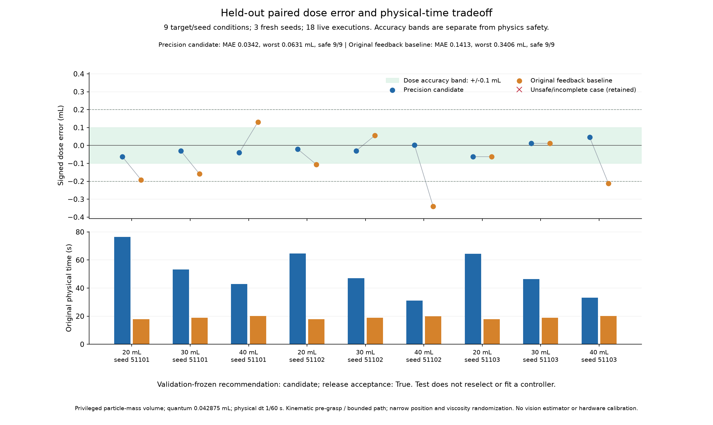
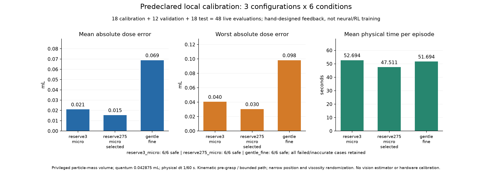
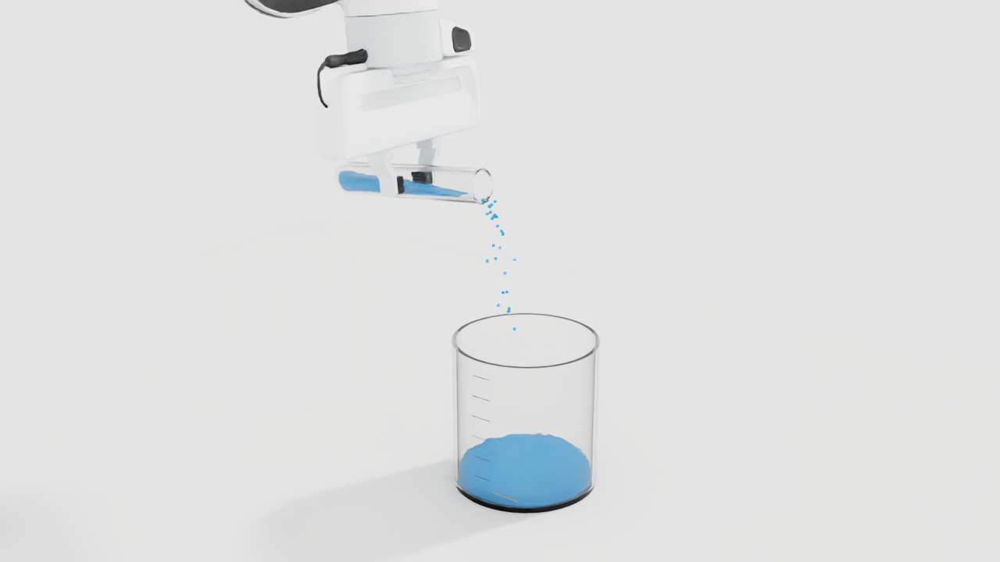

# 精密倒水 V2：2026-11-22

本轮完成 **18 次参数标定 + 12 次验证 + 18 次独立测试 = 48 次实时液体执行**，总计算约 70.4 分钟。每目标有三个新测试种子，按同初态配对原基准。V2 测试 MAE **0.034208 mL**，原基准 **0.141264 mL**，本组降低 **75.8%**；最差误差 **0.063125 / 0.340625 mL**。V2 9/9 在 ±0.1 mL 内，基准 3/9；两者物理均安全。候选通过预声明 MAE≤0.1、最大≤0.2 mL、全部安全及质量守恒的门槛。

## 误差与耗时

有符号误差顺序为种子 51101 / 51102 / 51103；负数为欠量。动作时间包含落稳、补水和扶正；墙钟耗时受并发 GPU 负载影响。

| 目标 mL / 策略 | MAE mL | 最大绝对误差 mL | 三例有符号误差 mL | 平均物理秒 | 平均墙钟秒 |
| --- | ---: | ---: | --- | ---: | ---: |
| 20 / V2 | 0.048833 | 0.063125 | -0.063125 / -0.020250 / -0.063125 | 68.49 | 89.91 |
| 20 / 原基准 | 0.120292 | 0.191750 | -0.191750 / -0.106000 / -0.063125 | 17.79 | 37.29 |
| 30 / V2 | 0.024417 | 0.030375 | -0.030375 / -0.030375 / +0.012500 | 48.92 | 77.26 |
| 30 / 原基准 | 0.075625 | 0.159000 | -0.159000 / +0.055375 / +0.012500 | 18.89 | 44.22 |
| 40 / V2 | 0.029375 | 0.045250 | -0.040500 / +0.002375 / +0.045250 | 35.70 | 69.78 |
| 40 / 原基准 | 0.227875 | 0.340625 | +0.131000 / -0.340625 / -0.212000 | 20.03 | 51.41 |

V2 平均物理时间 **51.04 秒**，基准 **18.91 秒**，约为 **2.70 倍**；平均墙钟 **78.98 / 44.31 秒**。精度改善伴随更长动作时间。

## 为什么旧 CEM 没有提升

旧方法只搜索停止偏置、余流预测时间和目标斜率三个参数；54 次训练实际评估18个候选、16组不同参数，仅复用三个固定训练条件。基准训练 MAE 0.0125 mL 已接近该目标组合的粒子下界 0.011708 mL，优化空间很小。末端流量约7–9 mL/s，停止后仍有约1.5–1.8 mL余流；欠量小于1 mL不补，原补倒一口又约3 mL，单改停止时机无法细修。

V2 加入 **粗倒预留 → 局部回倾 → 落稳复测 → 慢探倾微脉冲 → 扶正**，并消除轨迹端点速度跳变。只对三组预声明配置做有限标定，选中 reserve275_micro（预留2.75 mL、探倾路径速率0.003、单粒脉冲预算、粗/细回倾路径距离0.04/0.008）。路径速率是源轨迹秒/物理秒，不是角速度；轨迹导数可换算到实际倾角速度。本轮是手工反馈结构与参数标定，**不是 CEM、PPO 或神经网络训练**。

配置由标定集选择，候选/基准由验证集选择；两模型在首个 test reset 前冻结，测试不改参数和推荐。全部48回合、115851次物理更新（1930.85物理秒）、11个来源快照、日志footer、质量分区及模型SHA通过审计。未选 gentle_fine 有两例内部 irreversible_overdose 状态（误差 +0.098250/+0.088125 mL），仍保留；原基准端点 snap 另列诊断，不追改旧协议判定。

## Isaac Sim 额外画面复验

以下三个 nominal 回合使用原逐步调度、禁用 GUI CUDA graph，另算，不属于48回合或新留出测试。蓝色液体与实际空中粒子显示保留。

| 目标 mL | 入杯 mL | 误差 mL | 物理秒 | 补水脉冲 | 物理与精度 |
| --- | ---: | ---: | ---: | ---: | --- |
| 20 | 19.936875 | -0.063125 | 74.73 | 14 | 通过 |
| 30 | 30.012500 | +0.012500 | 33.47 | 2 | 通过 |
| 40 | 39.959500 | -0.040500 | 33.45 | 2 | 通过 |

入口 `robot_target_volume_precision.py` 支持 **Precision V2 / Original baseline**。新的 `precision_v2.json` 保留冻结字节；旧 quick/full 权重与入口不覆盖。设 `ISAAC_FLUID_DEMO=precision` 后使用 `launch.py`，或在 Script Editor 按 README 的显式路径片段加载新入口。48回合已达预设精度标准，本次不再追加搜索；若后续需要缩短时间，可另开协议，把几档倾倒速度与停止参数纳入 CEM，仍实时真倒、用验证集选模型。

## 适用边界与复现

粒子量化 **0.042875 mL**，mL 是固定粒子质量/密度的仿真真值；不是相机估计、真实电子秤或硬件计量精度。运动学预握、限定路径，位置微扰仅0.03粒间距、黏度±10%，样本很小；不代表跨杯型、抓持误差或实机泛化。不调整显示刻度、质量或粒距来凑目标。原始日志全部本地保留，公开[精选逐条件数据及SHA](../results/precision_v2_20261122.json)。

SDK 环境下运行 `train_target_volume_precision.py --help`；默认读取 `configs/precision_v2_calibration.json`，会真实执行48次而非回放。完整新运行结束后使用 `tools/training/audit_precision_run.py --run <run>` 和 `tools/training/plot_precision_results.py <run> --with-trace` 审计及绘图。公开源码做可移植路径转换，SHA与本机原运行快照不同，应重新开始，不能直接续跑本机原日志。
